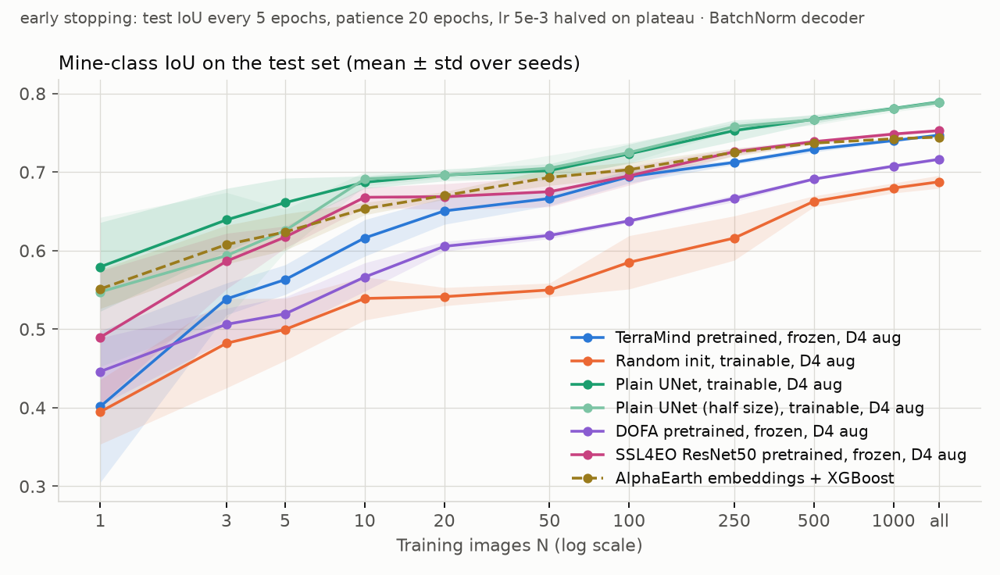
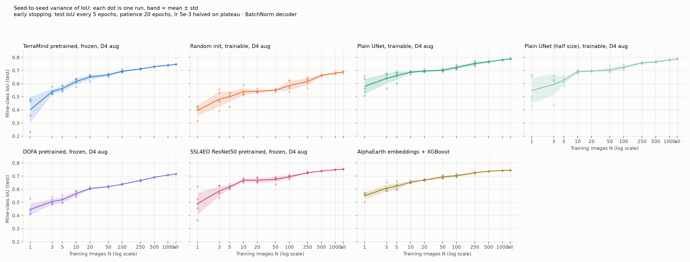
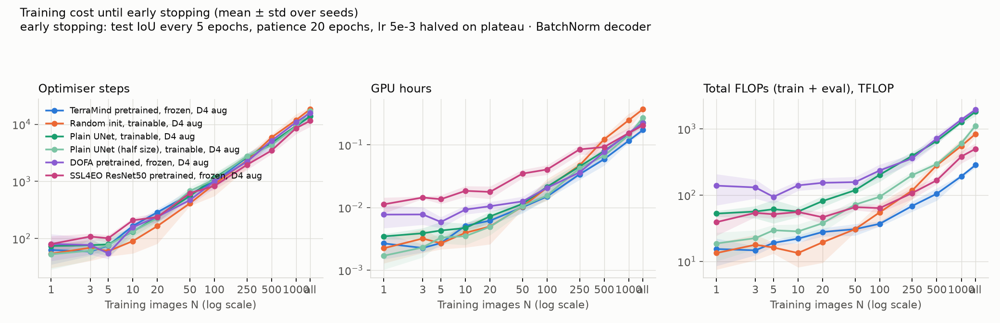

# TerraMind v1 Tiny on SmallMinesDS

Training-data efficiency for binary mine segmentation on
[SmallMinesDS](https://huggingface.co/datasets/ellaampy/SmallMinesDS) (2022, Sentinel-1 + Sentinel-2):
a frozen, pretrained [TerraMind v1 tiny](https://huggingface.co/ibm-esa-geospatial/TerraMind-1.0-tiny)
encoder versus the same encoder trained from scratch (Experiment 2); plain UNets trained from
scratch with the same and with half the number of parameters (Experiments 3 and 3 v2); two other
frozen foundation-model encoders, DOFA (a transformer) and an SSL4EO-S12 ResNet50 (a CNN), with
the same decoder (Experiment 4); and the 2022 AlphaEarth Foundations embeddings classified per
pixel with XGBoost (Experiment 5). Every model is trained on the same subsets of N training
images and scored on the same 644 test images. Each run trains until its test IoU stops
improving, and reports IoU together with its cost.

Everything needed to reproduce the 343 runs (294 deep-learning runs + 49 XGBoost runs) is in this
repository: pinned dependencies, pinned dataset and embedding sources, deterministic training,
and the analysis scripts.

## Requirements

- Windows/Linux with an NVIDIA GPU (tested: RTX 3080 Laptop 8 GB) and a driver that supports CUDA 12.8
- Python 3.12
- ~8 GB disk: 1.6 GB dataset zip, 1.8 GB extracted, 1.7 GB cache, 2.2 GB AlphaEarth embeddings

## Setup

On Windows, clone into a short path (e.g. `C:\projects\`) or enable long-path support:
some PyTorch/TerraTorch package files exceed the default 260-character path limit and
`pip install` fails in deeply nested folders.

```powershell
python -m venv .venv
.\.venv\Scripts\Activate.ps1
pip install -r requirements-lock.txt   # exact environment of the reported runs (or requirements.txt: direct dependencies only)
python scripts\check_gpu.py        # must print "OK: GPU works with PyTorch."
python scripts\download_data.py    # SmallMinesDS from Hugging Face, pinned revision, checksum verified
python scripts\build_cache.py      # normalised per-split arrays in data/cache/
python scripts\download_alphaearth.py  # 2022 AlphaEarth embeddings under every patch (Experiment 5 only)
```

## Run

```powershell
python scripts\run_experiments.py  # all deep-learning conditions: 294 runs, ~12 h on an RTX 3080 Laptop; resumable
python scripts\run_alphaearth.py   # AlphaEarth + XGBoost: 49 runs on the CPU, ~3 h
python scripts\analyze.py --runs results/main/runs.csv results/alphaearth/runs.csv   # tables + figures in results/main/

# partial runs, e.g. only N <= 250 or one seed
python scripts\run_experiments.py --budgets 1 3 5 10 20 50 100 250
python scripts\run_experiments.py --seeds 0
python scripts\run_experiments.py --encoders unet   # one condition: pretrained random unet unet_half dofa resnet50
```

`run_experiments.py` appends one row per run to the runs file and skips runs already present,
so it can be interrupted and restarted. The repository ships the reported results in
`results/main/runs.csv`, so on a fresh clone the default command finds every run done; to
rerun from scratch, write to a new file, e.g. `python scripts\run_experiments.py --out results/rerun/runs.csv`
(then `python scripts\analyze.py --runs results/rerun/runs.csv`). TerraMind weights are
and the DOFA and SSL4EO-S12 ResNet50 weights are downloaded on first use.

## Experiment

Research question: how does training-set size affect mine segmentation for a frozen pretrained
TerraMind v1 tiny encoder, how does it compare with the same architecture trained from scratch,
with plain UNets trained from scratch, with other frozen foundation-model encoders and with
AlphaEarth embeddings, and what does each cost to train?

| | Experiment | Model | Init | Training | Inputs |
|---|---|---|---|---|---|
| A | 2 | TerraMind v1 tiny + UNet decoder (6.90 M) | encoder pretrained | encoder frozen | S2 + S1 |
| B | 2 | TerraMind v1 tiny + UNet decoder (6.90 M) | random | all trainable | S2 + S1 |
| C | 3 | plain UNet (6.83 M) | random | all trainable | S2 + S1 |
| D | 3 v2 | plain UNet, half size (3.35 M) | random | all trainable | S2 + S1 |
| E | 4 | DOFA base + UNet decoder (111.2 M + 5.0 M) | encoder pretrained | encoder frozen | S2 + S1 |
| F | 4 | SSL4EO-S12 ResNet50 + UNet decoder (25.6 M + 4.2 M) | encoder pretrained | encoder frozen | S2 only |
| G | 5 | AlphaEarth 2022 embeddings + XGBoost (per pixel) | embeddings pretrained | trees only | AlphaEarth 64-dim |

A–F all use random D4 augmentation and exactly the same protocol, subsets and seeds; G uses the
same subsets, seeds and test set with its own stopping rule (see Experiment 5 below).

- Budgets N ∈ {1, 3, 5, 10, 20, 50, 100, 250} training images with 5 seeds, plus
  N ∈ {500, 1000, all = 1491} with 3 seeds; 49 runs per condition (A–F: 294 runs, G: 49).
- Subsets are nested within a seed and identical across all conditions.
- **Stopping rule (no fixed epoch or step count).** Test IoU is checked every 5 epochs for
  every N. A check counts as an improvement when IoU exceeds the best so far by more than
  10⁻³. Training stops at the first check that comes 20 or more epochs after the best check
  (4 non-improving checks). The reported model is the one at the best check.
- **Optimiser.** AdamW, weight decay 0.01, batch size min(8, N), unweighted 2-class pixel
  cross-entropy, reshuffle every epoch, final partial batch kept. The learning rate starts at
  5e-3 and is halved at every non-improving check, never below 1e-5.
- **D4 augmentation:** one of the 8 square symmetries (rotations by 0/90/180/270°, each with or
  without a horizontal flip), uniform, re-drawn per image presentation, applied identically to
  S1, S2 and the mask. Test images are never augmented.
- **Metric:** mine-class IoU from confusion counts pooled over the fixed 644-image test set,
  at the best check. F1, precision and recall from the same counts are in `results/main/runs.csv`.
- **Cost per run:** optimiser steps, epochs (best and stop), FLOPs, wall-clock GPU hours and the
  GPU name. FLOPs are counted once per run with `torch.utils.flop_counter` for one training
  sample (forward + backward; the frozen encoder has no backward pass) and one evaluated sample
  (forward), then multiplied by the samples actually processed; `flops_total` includes every
  test check. GPU hours are the wall-clock time of the whole run (model build, training, checks).
- Note: the stopping rule reads the test set, so the reported IoU is the best test value seen
  during training; this was the agreed protocol and applies equally to all conditions.

### Data

- SmallMinesDS 2022: 2135 patches of 128×128 px, train 1491 / test 644 (the dataset's own split).
- Inputs: Sentinel-2 L2A bands B2, B3, B4, B5, B6, B7, B8, B8A, B11, B12 and Sentinel-1 RTC
  VV, VH. The DEM band is not used.
- S1 is stored linear in the GeoTIFFs and converted to dB (10·log10) because TerraMind was
  pretrained on dB. Both modalities are standardised with TerraMind's pretraining mean/std
  (`data/cache/normalisation.json`), in every condition.
- Images are used at their native 128×128 (no resizing). TerraMind's fixed sin-cos positional
  table built for 128 px is exactly the top-left 8×8 crop of the 224 px table, so pretrained
  weights load unchanged.

### Model

Conditions A and B, built with [TerraTorch](https://github.com/IBM/terratorch) 1.2.13, identical in both:

- Encoder `terramind_v1_tiny` (5.92 M params): S2L2A + S1RTC tokens are processed as one joint
  sequence; per-layer outputs of the two modalities are averaged (`merge_method="mean"`).
- Decoder side (0.97 M params, randomly initialised in every run): encoder layers 2/5/8/11 →
  8×8 maps → learned pyramid (32/16/8/4 px) → 4-block UNet decoder with 128/64/32/16 channels →
  1×1 conv to 2 classes → bilinear ×2 to 128×128. Normalisation layers are BatchNorm2d
  (`--norm groupnorm` swaps them for GroupNorm).

Conditions C and D are plain UNets (Ronneberger et al. 2015, `smallmines/model.py`). C has 6.83 M params,
within 1 % of A/B's 6.90 M. The 12 input channels are concatenated. Encoder (4.15 M): 5
double-conv stages (3×3 conv + BatchNorm + ReLU, twice) with 30/60/120/240/480 channels and
2×2 max-pooling between them, so 128×128 goes down to an 8×8 bottleneck, the same grid as
TerraMind's tokens. Decoder (2.68 M): 4 transposed-conv upsamplings, each concatenated with the
skip connection and followed by a double conv, then a 1×1 conv to 2 classes. All weights use
PyTorch's default initialisation from the seed. D is the same network with 21/42/84/168/336
channels: 3.35 M params (encoder 2.03 M, decoder 1.31 M), half of C (the nearest integer width).

Conditions E and F (`build_foundation_model` in `smallmines/model.py`) swap TerraMind for another
frozen pretrained encoder from TerraTorch and keep everything else: the same 4-block UNet decoder
with 128/64/32/16 channels, head, seeds and training. Their decoder side is larger than A's
because their features are wider.

- E, `dofa_base_patch16_224` (DOFA, a ViT-base whose patch embedding is generated from each
  band's wavelength): all 12 bands (S2 by wavelength; S1 VV/VH at 5.405 GHz), the same
  standardised inputs as A, img_size 128 → 8×8 tokens of dim 768; layers 2/5/8/11 → 8×8 maps
  (CLS token dropped) → learned pyramid 32/16/8/4 px, as in A.
- F, `ssl4eos12_resnet50_sentinel2_all_moco` (ResNet50 pretrained with MoCo on SSL4EO-S12
  Sentinel-2 L1C): the 10 S2 bands only, rescaled to reflectance / 10000 as in its pretraining
  (the model has no S1 input); its four stages at 32/16/8/4 px feed the decoder directly.
  The encoder count includes the unused classification layer (2.0 M).

### Experiment 5: AlphaEarth embeddings + XGBoost

`scripts/download_alphaearth.py` reads the 2022 AlphaEarth Foundations Satellite Embedding
(Google / Google DeepMind, CC-BY 4.0; 64 dimensions per 10 m pixel) from its public COG mirror on
[Source Cooperative](https://source.coop/tge-labs/aef) for every SmallMinesDS patch. The
patches are in UTM 30N on the same 10 m grid as the embeddings, so no resampling is needed; no
patch pixel lacks an embedding. `scripts/run_alphaearth.py` then trains, per (seed, N), an
XGBoost classifier on the pixels of exactly the same N training patches (every pixel = its
64-dim embedding and its mask label; at most 2²² pixels, a random sample, which only affects
N ≥ 500) and scores all pixels of the 644 test patches with the same pooled IoU. XGBoost:
binary logistic loss, hist trees on the CPU, learning rate 0.1, depth 6, other parameters at
their defaults. Stopping mirrors the deep-learning rule: test IoU every 25 boosting rounds,
improvement > 10⁻³, stop 100 rounds (4 checks) after the best check; the best check is reported.

### Choices the plan left open

- **Low-N subsets.** 34 % of the training images contain no mine pixels. Per seed, the first 10
  images of the ordering are drawn at random from the 140 training images whose mine fraction
  lies in [0.25, 0.75]; the remaining images follow in random order. So N ≤ 10 budgets consist
  entirely of such images and larger budgets contain at least those 10.
  `results/main/subsets.json` lists the patch ids of every (seed, N) subset.
- **Seed.** One seed fixes the subset, the decoder initialisation and the per-epoch batch
  order, so the conditions of a seed are paired; augmentation draws come from a separate
  seeded stream. The random-init encoder and the UNets are also initialised from the seed.
- **Determinism.** cuDNN deterministic mode, `CUBLAS_WORKSPACE_CONFIG=:4096:8`,
  `torch.use_deterministic_algorithms(True)`, math attention kernel, and a cross-entropy
  written without the non-deterministic `nll_loss2d` kernel. Repeated runs are bit-identical
  on the same machine/software stack (verified on a clean clone of this repository).

## Results

All runs: `results/main/runs.csv` (conditions A–F, one row per run with confusion counts, the IoU
of every check, per-epoch training loss and all cost columns) and `results/alphaearth/runs.csv`
(condition G); combined tables in `results/main/summary.md`. Every run stopped by its patience
rule; no metric is NA. Compute on an RTX 3080 Laptop GPU: A 1.43, B 2.69, C 1.88, D 1.86,
E 1.91, F 2.52 GPU hours; G 2.9 h on 12 CPU threads.




### Mine-class IoU on the test set (mean ± std over seeds)

| N | seeds | A: TerraMind frozen | B: TerraMind from scratch | C: UNet | D: UNet, half size | E: DOFA frozen | F: ResNet50 frozen | G: AlphaEarth + XGBoost |
|---|---|---|---|---|---|---|---|---|
| 1 | 5 | 0.402 ± 0.096 | 0.395 ± 0.041 | 0.579 ± 0.057 | 0.547 ± 0.095 | 0.446 ± 0.043 | 0.490 ± 0.085 | 0.551 ± 0.025 |
| 3 | 5 | 0.539 ± 0.020 | 0.482 ± 0.057 | 0.639 ± 0.040 | 0.594 ± 0.080 | 0.506 ± 0.021 | 0.587 ± 0.035 | 0.608 ± 0.025 |
| 5 | 5 | 0.563 ± 0.019 | 0.500 ± 0.040 | 0.661 ± 0.031 | 0.626 ± 0.027 | 0.519 ± 0.022 | 0.617 ± 0.014 | 0.624 ± 0.023 |
| 10 | 5 | 0.616 ± 0.023 | 0.539 ± 0.027 | 0.687 ± 0.008 | 0.691 ± 0.009 | 0.566 ± 0.018 | 0.668 ± 0.013 | 0.653 ± 0.008 |
| 20 | 5 | 0.651 ± 0.017 | 0.541 ± 0.012 | 0.696 ± 0.008 | 0.696 ± 0.003 | 0.605 ± 0.006 | 0.669 ± 0.016 | 0.670 ± 0.005 |
| 50 | 5 | 0.666 ± 0.009 | 0.550 ± 0.009 | 0.702 ± 0.009 | 0.705 ± 0.016 | 0.619 ± 0.004 | 0.675 ± 0.019 | 0.693 ± 0.010 |
| 100 | 5 | 0.694 ± 0.008 | 0.585 ± 0.034 | 0.723 ± 0.012 | 0.725 ± 0.013 | 0.638 ± 0.002 | 0.695 ± 0.012 | 0.703 ± 0.010 |
| 250 | 5 | 0.712 ± 0.003 | 0.616 ± 0.028 | 0.753 ± 0.013 | 0.758 ± 0.005 | 0.666 ± 0.004 | 0.726 ± 0.004 | 0.725 ± 0.005 |
| 500 | 3 | 0.729 ± 0.004 | 0.663 ± 0.007 | 0.767 ± 0.005 | 0.767 ± 0.007 | 0.691 ± 0.001 | 0.739 ± 0.003 | 0.737 ± 0.001 |
| 1000 | 3 | 0.740 ± 0.002 | 0.680 ± 0.006 | 0.781 ± 0.001 | 0.780 ± 0.004 | 0.708 ± 0.002 | 0.748 ± 0.002 | 0.742 ± 0.001 |
| all (1491) | 3 | 0.747 ± 0.001 | 0.688 ± 0.008 | 0.789 ± 0.003 | 0.789 ± 0.004 | 0.716 ± 0.001 | 0.753 ± 0.002 | 0.744 ± 0.000 |

### Training cost until early stopping (mean ± std over seeds)



A: TerraMind frozen:

| N | best epoch | stop epoch | steps | GPU hours | train TFLOP | total TFLOP |
|---|---|---|---|---|---|---|
| 1 | 43.0 ± 28.0 | 63.0 ± 28.0 | 63 ± 28 | 0.003 ± 0.001 | 0.1 ± 0.1 | 15.4 ± 6.8 |
| 3 | 39.0 ± 9.2 | 59.0 ± 9.2 | 59 ± 9 | 0.002 ± 0.000 | 0.4 ± 0.1 | 14.7 ± 2.3 |
| 5 | 55.0 ± 8.9 | 75.0 ± 8.9 | 75 ± 9 | 0.003 ± 0.000 | 0.9 ± 0.1 | 19.0 ± 2.3 |
| 10 | 63.0 ± 10.8 | 83.0 ± 10.8 | 166 ± 22 | 0.005 ± 0.001 | 2.0 ± 0.3 | 22.0 ± 2.9 |
| 20 | 76.0 ± 13.9 | 96.0 ± 13.9 | 288 ± 42 | 0.006 ± 0.001 | 4.6 ± 0.7 | 27.7 ± 4.0 |
| 50 | 65.0 ± 17.0 | 85.0 ± 17.0 | 595 ± 119 | 0.010 ± 0.002 | 10.1 ± 2.0 | 30.6 ± 6.1 |
| 100 | 57.0 ± 6.8 | 77.0 ± 6.8 | 1001 ± 88 | 0.015 ± 0.001 | 18.3 ± 1.6 | 36.9 ± 3.2 |
| 250 | 62.0 ± 14.4 | 82.0 ± 14.4 | 2624 ± 459 | 0.034 ± 0.006 | 48.7 ± 8.5 | 68.4 ± 12.0 |
| 500 | 53.3 ± 15.5 | 73.3 ± 15.5 | 4620 ± 974 | 0.059 ± 0.012 | 87.0 ± 18.3 | 104.7 ± 22.1 |
| 1000 | 53.3 ± 4.7 | 73.3 ± 4.7 | 9167 ± 589 | 0.116 ± 0.007 | 174.1 ± 11.2 | 191.8 ± 12.3 |
| all (1491) | 55.0 ± 7.1 | 75.0 ± 7.1 | 14025 ± 1322 | 0.172 ± 0.017 | 265.4 ± 25.0 | 283.5 ± 26.7 |

B: TerraMind from scratch:

| N | best epoch | stop epoch | steps | GPU hours | train TFLOP | total TFLOP |
|---|---|---|---|---|---|---|
| 1 | 34.0 ± 23.5 | 54.0 ± 23.5 | 54 ± 24 | 0.002 ± 0.001 | 0.3 ± 0.1 | 13.3 ± 5.8 |
| 3 | 49.0 ± 28.5 | 69.0 ± 28.5 | 69 ± 29 | 0.003 ± 0.001 | 1.1 ± 0.5 | 17.8 ± 7.4 |
| 5 | 40.0 ± 11.4 | 60.0 ± 11.4 | 60 ± 11 | 0.003 ± 0.001 | 1.7 ± 0.3 | 16.1 ± 3.1 |
| 10 | 25.0 ± 17.6 | 45.0 ± 17.6 | 90 ± 35 | 0.004 ± 0.002 | 2.5 ± 1.0 | 13.4 ± 5.2 |
| 20 | 35.0 ± 27.9 | 55.0 ± 27.9 | 165 ± 84 | 0.005 ± 0.002 | 6.1 ± 3.1 | 19.4 ± 9.8 |
| 50 | 39.0 ± 5.8 | 59.0 ± 5.8 | 413 ± 41 | 0.010 ± 0.001 | 16.4 ± 1.6 | 30.6 ± 3.0 |
| 100 | 49.0 ± 26.3 | 69.0 ± 26.3 | 897 ± 342 | 0.021 ± 0.008 | 38.3 ± 14.6 | 54.9 ± 21.0 |
| 250 | 52.0 ± 19.1 | 72.0 ± 19.1 | 2304 ± 612 | 0.047 ± 0.012 | 99.8 ± 26.5 | 117.2 ± 31.1 |
| 500 | 73.3 ± 12.5 | 93.3 ± 12.5 | 5880 ± 786 | 0.122 ± 0.015 | 258.7 ± 34.6 | 281.3 ± 37.6 |
| 1000 | 75.0 ± 25.5 | 95.0 ± 25.5 | 11875 ± 3187 | 0.247 ± 0.069 | 526.7 ± 141.4 | 549.7 ± 147.5 |
| all (1491) | 78.3 ± 8.5 | 98.3 ± 8.5 | 18388 ± 1589 | 0.370 ± 0.031 | 812.9 ± 70.3 | 836.6 ± 72.3 |

C: UNet:

| N | best epoch | stop epoch | steps | GPU hours | train TFLOP | total TFLOP |
|---|---|---|---|---|---|---|
| 1 | 54.0 ± 7.3 | 74.0 ± 7.3 | 74 ± 7 | 0.003 ± 0.000 | 1.2 ± 0.1 | 52.5 ± 5.2 |
| 3 | 56.0 ± 15.9 | 76.0 ± 15.9 | 76 ± 16 | 0.004 ± 0.001 | 3.7 ± 0.8 | 56.4 ± 11.8 |
| 5 | 59.0 ± 30.7 | 79.0 ± 30.7 | 79 ± 31 | 0.004 ± 0.002 | 6.3 ± 2.5 | 61.2 ± 23.8 |
| 10 | 46.0 ± 11.6 | 66.0 ± 11.6 | 132 ± 23 | 0.005 ± 0.001 | 10.6 ± 1.9 | 56.4 ± 9.9 |
| 20 | 60.0 ± 15.2 | 80.0 ± 15.2 | 240 ± 45 | 0.007 ± 0.001 | 25.7 ± 4.9 | 81.2 ± 15.4 |
| 50 | 59.0 ± 9.2 | 79.0 ± 9.2 | 553 ± 64 | 0.011 ± 0.001 | 63.4 ± 7.4 | 118.2 ± 13.7 |
| 100 | 68.0 ± 18.9 | 88.0 ± 18.9 | 1144 ± 245 | 0.021 ± 0.005 | 141.3 ± 30.3 | 202.3 ± 43.4 |
| 250 | 63.0 ± 12.9 | 83.0 ± 12.9 | 2656 ± 412 | 0.045 ± 0.007 | 333.1 ± 51.7 | 390.7 ± 60.7 |
| 500 | 55.0 ± 7.1 | 75.0 ± 7.1 | 4725 ± 445 | 0.079 ± 0.008 | 602.1 ± 56.8 | 654.1 ± 61.7 |
| 1000 | 55.0 ± 4.1 | 75.0 ± 4.1 | 9375 ± 510 | 0.150 ± 0.007 | 1204.1 ± 65.5 | 1256.2 ± 68.4 |
| all (1491) | 53.3 ± 10.3 | 73.3 ± 10.3 | 13713 ± 1921 | 0.227 ± 0.042 | 1755.5 ± 245.9 | 1806.3 ± 253.1 |

D: UNet, half size:

| N | best epoch | stop epoch | steps | GPU hours | train TFLOP | total TFLOP |
|---|---|---|---|---|---|---|
| 1 | 33.0 ± 24.4 | 53.0 ± 24.4 | 53 ± 24 | 0.002 ± 0.001 | 0.4 ± 0.2 | 18.6 ± 8.6 |
| 3 | 41.0 ± 19.3 | 61.0 ± 19.3 | 61 ± 19 | 0.002 ± 0.001 | 1.4 ± 0.5 | 22.4 ± 7.1 |
| 5 | 57.0 ± 15.7 | 77.0 ± 15.7 | 77 ± 16 | 0.003 ± 0.001 | 3.0 ± 0.6 | 29.5 ± 6.0 |
| 10 | 47.0 ± 18.6 | 67.0 ± 18.6 | 134 ± 37 | 0.003 ± 0.001 | 5.3 ± 1.5 | 28.3 ± 7.9 |
| 20 | 55.0 ± 20.0 | 75.0 ± 20.0 | 225 ± 60 | 0.005 ± 0.001 | 11.9 ± 3.2 | 37.6 ± 10.0 |
| 50 | 77.0 ± 17.8 | 97.0 ± 17.8 | 679 ± 124 | 0.010 ± 0.002 | 38.4 ± 7.0 | 71.6 ± 13.1 |
| 100 | 63.0 ± 16.0 | 83.0 ± 16.0 | 1079 ± 208 | 0.016 ± 0.003 | 65.7 ± 12.7 | 94.1 ± 18.1 |
| 250 | 66.0 ± 11.6 | 86.0 ± 11.6 | 2752 ± 370 | 0.042 ± 0.007 | 170.1 ± 22.9 | 199.6 ± 26.9 |
| 500 | 48.3 ± 6.2 | 68.3 ± 6.2 | 4305 ± 393 | 0.067 ± 0.006 | 270.4 ± 24.7 | 293.8 ± 26.8 |
| 1000 | 53.3 ± 6.2 | 73.3 ± 6.2 | 9167 ± 780 | 0.142 ± 0.012 | 580.3 ± 49.3 | 605.4 ± 51.5 |
| all (1491) | 71.7 ± 15.5 | 91.7 ± 15.5 | 17142 ± 2890 | 0.271 ± 0.048 | 1081.5 ± 182.3 | 1112.9 ± 187.6 |

E: DOFA frozen:

| N | best epoch | stop epoch | steps | GPU hours | train TFLOP | total TFLOP |
|---|---|---|---|---|---|---|
| 1 | 60.0 ± 39.6 | 80.0 ± 39.6 | 80 ± 40 | 0.008 ± 0.003 | 1.2 ± 0.6 | 138.6 ± 68.6 |
| 3 | 57.0 ± 24.6 | 77.0 ± 24.6 | 77 ± 25 | 0.008 ± 0.002 | 3.3 ± 1.1 | 130.4 ± 41.7 |
| 5 | 35.0 ± 11.4 | 55.0 ± 11.4 | 55 ± 11 | 0.006 ± 0.001 | 3.9 ± 0.8 | 94.0 ± 19.5 |
| 10 | 59.0 ± 13.2 | 79.0 ± 13.2 | 158 ± 26 | 0.009 ± 0.001 | 11.2 ± 1.9 | 139.9 ± 23.4 |
| 20 | 60.0 ± 14.8 | 80.0 ± 14.8 | 240 ± 44 | 0.010 ± 0.002 | 22.8 ± 4.2 | 153.1 ± 28.4 |
| 50 | 47.0 ± 13.6 | 67.0 ± 13.6 | 469 ± 95 | 0.012 ± 0.002 | 47.7 ± 9.7 | 156.8 ± 31.9 |
| 100 | 57.0 ± 17.8 | 77.0 ± 17.8 | 1001 ± 231 | 0.021 ± 0.005 | 109.5 ± 25.3 | 235.0 ± 54.2 |
| 250 | 49.0 ± 10.7 | 69.0 ± 10.7 | 2208 ± 342 | 0.036 ± 0.006 | 245.4 ± 38.0 | 357.8 ± 55.4 |
| 500 | 61.7 ± 14.3 | 81.7 ± 14.3 | 5145 ± 903 | 0.077 ± 0.014 | 580.9 ± 102.0 | 713.9 ± 125.3 |
| 1000 | 66.7 ± 6.2 | 86.7 ± 6.2 | 10833 ± 780 | 0.155 ± 0.010 | 1232.9 ± 88.7 | 1374.1 ± 98.9 |
| all (1491) | 65.0 ± 8.2 | 85.0 ± 8.2 | 15895 ± 1527 | 0.221 ± 0.022 | 1802.9 ± 173.2 | 1941.3 ± 186.5 |

F: ResNet50 frozen:

| N | best epoch | stop epoch | steps | GPU hours | train TFLOP | total TFLOP |
|---|---|---|---|---|---|---|
| 1 | 60.0 ± 30.0 | 80.0 ± 30.0 | 80 ± 30 | 0.011 ± 0.003 | 0.4 ± 0.2 | 39.1 ± 14.6 |
| 3 | 88.0 ± 14.4 | 108.0 ± 14.4 | 108 ± 14 | 0.014 ± 0.001 | 1.7 ± 0.2 | 53.8 ± 7.2 |
| 5 | 81.0 ± 14.3 | 101.0 ± 14.3 | 101 ± 14 | 0.014 ± 0.002 | 2.6 ± 0.4 | 51.4 ± 7.3 |
| 10 | 84.0 ± 11.6 | 104.0 ± 11.6 | 208 ± 23 | 0.018 ± 0.004 | 5.3 ± 0.6 | 55.5 ± 6.2 |
| 20 | 59.0 ± 15.6 | 79.0 ± 15.6 | 237 ± 47 | 0.018 ± 0.004 | 8.1 ± 1.6 | 46.2 ± 9.1 |
| 50 | 69.0 ± 9.2 | 89.0 ± 9.2 | 623 ± 64 | 0.035 ± 0.005 | 22.7 ± 2.3 | 65.7 ± 6.8 |
| 100 | 44.0 ± 9.2 | 64.0 ± 9.2 | 832 ± 119 | 0.040 ± 0.007 | 32.6 ± 4.7 | 63.6 ± 9.1 |
| 250 | 41.0 ± 11.6 | 61.0 ± 11.6 | 1952 ± 370 | 0.084 ± 0.014 | 77.8 ± 14.8 | 107.2 ± 20.4 |
| 500 | 35.0 ± 7.1 | 55.0 ± 7.1 | 3465 ± 445 | 0.092 ± 0.026 | 140.2 ± 18.0 | 166.8 ± 21.4 |
| 1000 | 48.3 ± 14.3 | 68.3 ± 14.3 | 8542 ± 1792 | 0.154 ± 0.033 | 348.5 ± 73.1 | 381.5 ± 80.0 |
| all (1491) | 41.7 ± 13.1 | 61.7 ± 13.1 | 11532 ± 2454 | 0.204 ± 0.044 | 468.9 ± 99.8 | 498.7 ± 106.1 |

GPU: NVIDIA GeForce RTX 3080 Laptop GPU. FLOPs per training sample (forward + backward through
the trainable parts) / per evaluated sample: A 2.37 / 1.87, B 5.54 / 1.87, C 16.06 / 5.39,
D 7.91 / 2.66, E 14.91 / 13.33, F 5.10 / 3.75 GFLOP. D, E and F ran while the CPU was also busy
with G, so their GPU hours are somewhat inflated; FLOPs and IoU are unaffected. XGBoost (G) has
no step or FLOP accounting; its runs stopped after 125–775 boosting rounds.

### Findings

- **Plain UNets trained from scratch are the best models at every N**: C wins against A in
  every one of the 49 (seed, N) pairs; 0.789 with all images vs 0.753 for the best frozen
  encoder (F) and 0.747 for TerraMind (A).
- **Half the parameters cost nothing (Experiment 3 v2).** D (3.35 M) matches C (6.83 M) from
  N = 10 on (all images: 0.789 for both; better in 22 of 49 pairs) at half the FLOPs per sample;
  only at N ≤ 5 is it lower (0.547 vs 0.579 at N = 1) and more seed-dependent.
- **Among the frozen foundation models, the CNN beats both transformers (Experiment 4).** The
  SSL4EO ResNet50 (F, S2 only) is above TerraMind (A) in 42 of 49 pairs, most at small N
  (N = 10: 0.668 vs 0.616; all: 0.753 vs 0.747). DOFA (E) is the weakest pretrained model at
  every N ≥ 3 (all images: 0.716) despite the largest encoder (111 M).
- **AlphaEarth + XGBoost (Experiment 5)** is strong with very little data (N = 1: 0.551, second
  only to C) and above A at every N (45 of 49 pairs), but it plateaus: 0.737 → 0.742 → 0.744
  from N = 500 on, level with A and F and well below the UNets.
- **TerraMind from scratch (B)** stays the weakest model at every N ≥ 3.

## Earlier protocols (archived)

Earlier grids are kept for reference and are not part of the report:

- `results/es_check1/main/`: the same early-stopping protocol, but with the test check after
  every epoch for N > 100. Because the learning rate is halved at every non-improving check,
  it decayed up to five times faster per epoch there, and IoU at N ≥ 250 was 0.02–0.06 lower
  (frozen encoder: 0.653 at N = 250, 0.723 with all images).
- `results/es_4checks/main/`: the same early-stopping protocol with patience defined as
  4 checks instead of 20 epochs (identical for N ≤ 100; at N > 100 runs stopped after
  10–22 epochs).
- `results/fixed_50ep/main/`: 4 conditions (with and without augmentation), 50 epochs, cosine
  learning rate 5e-3 → 1e-5, 196 runs. It showed that augmentation helps the frozen encoder
  consistently (+0.02 to +0.04 IoU) and not the trainable one, which is why the current
  experiment keeps only the augmented conditions. Best IoU there: 0.745 (frozen + aug, all images).
- `results/v1_10ep/`: the plan document's original schedule (10 epochs, constant lr 1e-4) with
  two diagnostic variants; see `results/v1_10ep/variants.md`.

## Layout

```
smallmines/          data.py (loading, normalisation, subsets, D4), model.py, train.py, metrics.py
scripts/             check_gpu.py, download_data.py, build_cache.py, run_experiments.py,
                     download_alphaearth.py, run_alphaearth.py, analyze.py, compare_variants.py
results/main/        deep-learning conditions A-F: runs.csv, summary.csv, summary.md (all
                     conditions incl. G), subsets.json, environment.json, figures/
results/alphaearth/  AlphaEarth + XGBoost (G): runs.csv, environment.json
results/es_check1/   archived early-stopping grid with a check after every epoch for N > 100
results/es_4checks/  archived early-stopping grid with 4-check patience
results/fixed_50ep/  archived 50-epoch grid (4 conditions)
results/v1_10ep/     archived 10-epoch grid and its variants
report/              final report (TerraMind_SmallMinesDS_Final_Report.pdf) and the Experiment 2 report
data/                (git-ignored) dataset, split CSVs, cache
```
