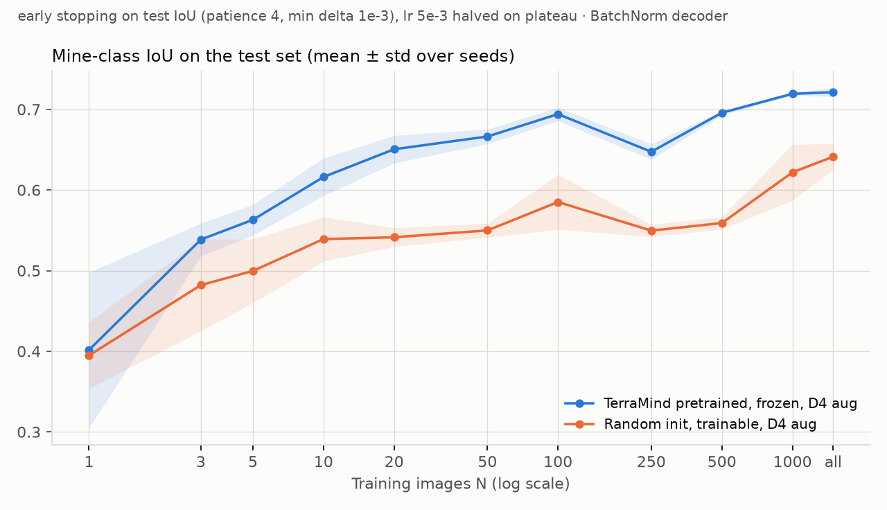
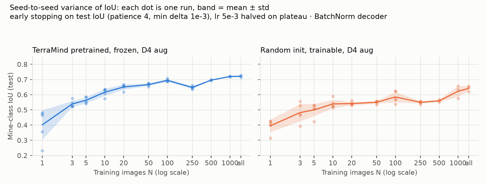
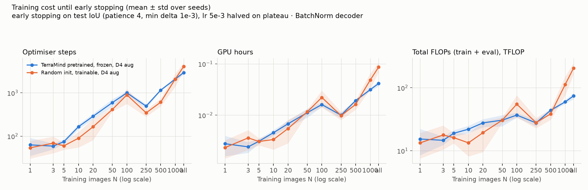

# TerraMind v1 Tiny on SmallMinesDS

Training-data efficiency for binary mine segmentation: a frozen, pretrained
[TerraMind v1 tiny](https://huggingface.co/ibm-esa-geospatial/TerraMind-1.0-tiny) encoder versus
the same encoder architecture trained from scratch, both with D4 augmentation, on
[SmallMinesDS](https://huggingface.co/datasets/ellaampy/SmallMinesDS) (2022, Sentinel-1 + Sentinel-2).
Each run trains until its test IoU stops improving, and reports IoU together with its cost:
optimiser steps, FLOPs, GPU hours and the GPU used.

Everything needed to reproduce the 98 runs is in this repository: pinned dependencies, a pinned
dataset revision, deterministic training, and the analysis scripts.

## Requirements

- Windows/Linux with an NVIDIA GPU (tested: RTX 3080 Laptop 8 GB) and a driver that supports CUDA 12.8
- Python 3.12
- ~6 GB disk: 1.6 GB dataset zip, 1.8 GB extracted, 1.7 GB cache

## Setup

On Windows, clone into a short path (e.g. `C:\projects\`) or enable long-path support:
some PyTorch/TerraTorch package files exceed the default 260-character path limit and
`pip install` fails in deeply nested folders.

```powershell
python -m venv .venv
.\.venv\Scripts\Activate.ps1
pip install -r requirements.txt
python scripts\check_gpu.py        # must print "OK: GPU works with PyTorch."
python scripts\download_data.py    # SmallMinesDS from Hugging Face, pinned revision, checksum verified
python scripts\build_cache.py      # normalised per-split arrays in data/cache/
```

## Run

```powershell
python scripts\run_experiments.py  # full experiment: 98 runs, ~80 min on an RTX 3080 Laptop; resumable
python scripts\analyze.py          # tables + figures in results/main/

# partial runs, e.g. only N <= 250 or one seed
python scripts\run_experiments.py --budgets 1 3 5 10 20 50 100 250
python scripts\run_experiments.py --seeds 0
```

`run_experiments.py` appends one row per run to the runs file and skips runs already present,
so it can be interrupted and restarted. The repository ships the reported results in
`results/main/runs.csv`, so on a fresh clone the default command finds every run done; to
rerun from scratch, write to a new file, e.g. `python scripts\run_experiments.py --out results/rerun/runs.csv`
(then `python scripts\analyze.py --runs results/rerun/runs.csv`). TerraMind weights are
downloaded from Hugging Face on first use.

## Experiment

Research question: how does training-set size affect mine segmentation for a frozen pretrained
TerraMind v1 tiny encoder versus the same architecture trained from scratch, and what does each
cost to train?

| | Encoder init | Encoder training | Augmentation |
|---|---|---|---|
| A | TerraMind v1 tiny, pretrained | frozen | random D4 symmetry |
| B | random | trainable | random D4 symmetry |

- Budgets N ∈ {1, 3, 5, 10, 20, 50, 100, 250} training images with 5 seeds, plus
  N ∈ {500, 1000, all = 1491} with 3 seeds; 2 conditions → 98 runs.
- Subsets are nested within a seed and identical across the two conditions.
- **Stopping rule (no fixed epoch or step count).** Test IoU is checked every 5 epochs for
  N ≤ 100 and after every epoch for N > 100. A check counts as an improvement when IoU exceeds
  the best so far by more than 10⁻³. Training stops after 4 consecutive checks without
  improvement. The reported model is the one at the best check.
- **Optimiser.** AdamW, weight decay 0.01, batch size min(8, N), unweighted 2-class pixel
  cross-entropy, reshuffle every epoch, final partial batch kept. The learning rate starts at
  5e-3 and is halved at every non-improving check, never below 1e-5.
- **D4 augmentation:** one of the 8 square symmetries (rotations by 0/90/180/270°, each with or
  without a horizontal flip), uniform, re-drawn per image presentation, applied identically to
  S1, S2 and the mask. Test images are never augmented.
- **Metric:** mine-class IoU from confusion counts pooled over the fixed 644-image test set,
  at the best check. F1, precision and recall from the same counts are in `results/main/runs.csv`.
- **Cost per run:** optimiser steps, epochs (best and stop), FLOPs, wall-clock GPU hours and the
  GPU name. FLOPs are counted once per run with `torch.utils.flop_counter` for one training
  sample (forward + backward; the frozen encoder has no backward pass) and one evaluated sample
  (forward), then multiplied by the samples actually processed; `flops_total` includes every
  test check. GPU hours are the wall-clock time of the whole run (model build, training, checks).
- Note: the stopping rule reads the test set, so the reported IoU is the best test value seen
  during training; this was the agreed protocol and applies equally to both conditions.

### Data

- SmallMinesDS 2022: 2135 patches of 128×128 px, train 1491 / test 644 (the dataset's own split).
- Inputs: Sentinel-2 L2A bands B2, B3, B4, B5, B6, B7, B8, B8A, B11, B12 and Sentinel-1 RTC
  VV, VH. The DEM band is not used.
- S1 is stored linear in the GeoTIFFs and converted to dB (10·log10) because TerraMind was
  pretrained on dB. Both modalities are standardised with TerraMind's pretraining mean/std
  (`data/cache/normalisation.json`), in every condition.
- Images are used at their native 128×128 (no resizing). TerraMind's fixed sin-cos positional
  table built for 128 px is exactly the top-left 8×8 crop of the 224 px table, so pretrained
  weights load unchanged.

### Model

Built with [TerraTorch](https://github.com/IBM/terratorch) 1.2.13, identical in both conditions:

- Encoder `terramind_v1_tiny` (5.92 M params): S2L2A + S1RTC tokens are processed as one joint
  sequence; per-layer outputs of the two modalities are averaged (`merge_method="mean"`).
- Decoder side (0.97 M params, randomly initialised in every run): encoder layers 2/5/8/11 →
  8×8 maps → learned pyramid (32/16/8/4 px) → 4-block UNet decoder with 128/64/32/16 channels →
  1×1 conv to 2 classes → bilinear ×2 to 128×128. Normalisation layers are BatchNorm2d
  (`--norm groupnorm` swaps them for GroupNorm).

### Choices the plan left open

- **Low-N subsets.** 34 % of the training images contain no mine pixels. Per seed, the first 10
  images of the ordering are drawn at random from the 140 training images whose mine fraction
  lies in [0.25, 0.75]; the remaining images follow in random order. So N ≤ 10 budgets consist
  entirely of such images and larger budgets contain at least those 10.
  `results/main/subsets.json` lists the patch ids of every (seed, N) subset.
- **Seed.** One seed fixes the subset, the decoder initialisation and the per-epoch batch
  order, so the two conditions of a seed are paired; augmentation draws come from a separate
  seeded stream. The random-init encoder is also initialised from the seed.
- **Determinism.** cuDNN deterministic mode, `CUBLAS_WORKSPACE_CONFIG=:4096:8`,
  `torch.use_deterministic_algorithms(True)`, math attention kernel, and a cross-entropy
  written without the non-deterministic `nll_loss2d` kernel. Repeated runs are bit-identical
  on the same machine/software stack (verified on a clean clone of this repository).

## Results

All 98 runs: `results/main/runs.csv` (one row per run with confusion counts, the IoU of every
check, per-epoch training loss and all cost columns), `results/main/summary.md`,
`results/main/environment.json`. Total compute: 79 min on an RTX 3080 Laptop GPU
(0.56 GPU hours for the frozen encoder, 0.76 for the trainable one). Every run stopped by the
patience rule; no metric is NA.




### Mine-class IoU on the test set (mean ± std over seeds)

| N | seeds | Pretrained, frozen + aug | Random init, trainable + aug |
|---|---|---|---|
| 1 | 5 | 0.402 ± 0.096 | 0.395 ± 0.041 |
| 3 | 5 | 0.539 ± 0.020 | 0.482 ± 0.057 |
| 5 | 5 | 0.563 ± 0.019 | 0.500 ± 0.040 |
| 10 | 5 | 0.616 ± 0.023 | 0.539 ± 0.027 |
| 20 | 5 | 0.651 ± 0.017 | 0.541 ± 0.012 |
| 50 | 5 | 0.666 ± 0.009 | 0.550 ± 0.009 |
| 100 | 5 | 0.694 ± 0.008 | 0.585 ± 0.034 |
| 250 | 5 | 0.647 ± 0.010 | 0.550 ± 0.008 |
| 500 | 3 | 0.696 ± 0.003 | 0.559 ± 0.008 |
| 1000 | 3 | 0.719 ± 0.002 | 0.622 ± 0.035 |
| all (1491) | 3 | 0.721 ± 0.005 | 0.641 ± 0.016 |

### Training cost until early stopping (mean ± std over seeds)



Pretrained, frozen + aug:

| N | best epoch | stop epoch | steps | GPU hours | train TFLOP | total TFLOP |
|---|---|---|---|---|---|---|
| 1 | 43.0 ± 28.0 | 63.0 ± 28.0 | 63 ± 28 | 0.003 ± 0.001 | 0.1 ± 0.1 | 15.4 ± 6.8 |
| 3 | 39.0 ± 9.2 | 59.0 ± 9.2 | 59 ± 9 | 0.002 ± 0.001 | 0.4 ± 0.1 | 14.7 ± 2.3 |
| 5 | 55.0 ± 8.9 | 75.0 ± 8.9 | 75 ± 9 | 0.003 ± 0.000 | 0.9 ± 0.1 | 19.0 ± 2.3 |
| 10 | 63.0 ± 10.8 | 83.0 ± 10.8 | 166 ± 22 | 0.005 ± 0.001 | 2.0 ± 0.3 | 22.0 ± 2.9 |
| 20 | 76.0 ± 13.9 | 96.0 ± 13.9 | 288 ± 42 | 0.007 ± 0.001 | 4.6 ± 0.7 | 27.7 ± 4.0 |
| 50 | 65.0 ± 17.0 | 85.0 ± 17.0 | 595 ± 119 | 0.011 ± 0.002 | 10.1 ± 2.0 | 30.6 ± 6.1 |
| 100 | 57.0 ± 6.8 | 77.0 ± 6.8 | 1001 ± 88 | 0.016 ± 0.002 | 18.3 ± 1.6 | 36.9 ± 3.2 |
| 250 | 11.4 ± 1.9 | 15.4 ± 1.9 | 493 ± 59 | 0.010 ± 0.001 | 9.1 ± 1.1 | 27.7 ± 3.3 |
| 500 | 14.3 ± 0.9 | 18.3 ± 0.9 | 1155 ± 59 | 0.019 ± 0.001 | 21.8 ± 1.1 | 43.9 ± 2.3 |
| 1000 | 12.7 ± 1.2 | 16.7 ± 1.2 | 2083 ± 156 | 0.031 ± 0.002 | 39.6 ± 3.0 | 59.7 ± 4.5 |
| all (1491) | 11.7 ± 1.7 | 15.7 ± 1.7 | 2930 ± 318 | 0.041 ± 0.005 | 55.4 ± 6.0 | 74.3 ± 8.1 |

Random init, trainable + aug:

| N | best epoch | stop epoch | steps | GPU hours | train TFLOP | total TFLOP |
|---|---|---|---|---|---|---|
| 1 | 34.0 ± 23.5 | 54.0 ± 23.5 | 54 ± 24 | 0.002 ± 0.001 | 0.3 ± 0.1 | 13.3 ± 5.8 |
| 3 | 49.0 ± 28.5 | 69.0 ± 28.5 | 69 ± 29 | 0.004 ± 0.002 | 1.1 ± 0.5 | 17.8 ± 7.4 |
| 5 | 40.0 ± 11.4 | 60.0 ± 11.4 | 60 ± 11 | 0.003 ± 0.000 | 1.7 ± 0.3 | 16.1 ± 3.1 |
| 10 | 25.0 ± 17.6 | 45.0 ± 17.6 | 90 ± 35 | 0.003 ± 0.001 | 2.5 ± 1.0 | 13.4 ± 5.2 |
| 20 | 35.0 ± 27.9 | 55.0 ± 27.9 | 165 ± 84 | 0.005 ± 0.003 | 6.1 ± 3.1 | 19.4 ± 9.8 |
| 50 | 39.0 ± 5.8 | 59.0 ± 5.8 | 413 ± 41 | 0.012 ± 0.001 | 16.4 ± 1.6 | 30.6 ± 3.0 |
| 100 | 49.0 ± 26.3 | 69.0 ± 26.3 | 897 ± 342 | 0.022 ± 0.008 | 38.3 ± 14.6 | 54.9 ± 21.0 |
| 250 | 6.8 ± 2.0 | 10.8 ± 2.0 | 346 ± 65 | 0.010 ± 0.002 | 15.0 ± 2.8 | 28.0 ± 5.3 |
| 500 | 5.7 ± 1.9 | 9.7 ± 1.9 | 609 ± 119 | 0.016 ± 0.003 | 26.8 ± 5.2 | 38.5 ± 7.5 |
| 1000 | 12.7 ± 5.6 | 16.7 ± 5.6 | 2083 ± 695 | 0.048 ± 0.017 | 92.4 ± 30.8 | 112.5 ± 37.5 |
| all (1491) | 17.7 ± 4.5 | 21.7 ± 4.5 | 4052 ± 841 | 0.086 ± 0.018 | 179.1 ± 37.2 | 205.3 ± 42.6 |

GPU: NVIDIA GeForce RTX 3080 Laptop GPU. Per-sample cost: 2.37 GFLOP per training sample for
the frozen encoder (decoder forward + backward only) vs 5.54 GFLOP for the trainable one;
1.87 GFLOP per evaluated sample for both. Test checks dominate the FLOPs at small N
(644 images per check).

### Findings

- **The frozen pretrained encoder wins at every N ≥ 5 in 5/5 seeds** (3/5 at N = 1 and 3), by
  +0.06 IoU at N = 3–5 and +0.08–0.14 from N = 10 on (0.721 vs 0.641 with all images).
- **Data efficiency.** With 20 images the frozen encoder (0.651) already exceeds what the
  trainable encoder reaches with all 1,491 (0.641).
- **Cost.** The frozen encoder trains with 2.3× fewer FLOPs per sample, and at the largest
  budgets it needs about half the GPU time (0.041 vs 0.086 h, 74 vs 205 TFLOP with all images);
  at N ≤ 100 both stop after a similar number of epochs and cost about the same.
- **Seed variance** is small for the frozen encoder from N = 3 on (std ≤ 0.023) and larger for
  the trainable one (up to 0.057).
- **Effect of the check cadence.** Budgets N ≤ 100 are checked every 5 epochs, so the patience
  window is 20 epochs and training runs 45–96 epochs before stopping; from N = 250 the check is
  every epoch, the window is 4 epochs, the learning rate is halved at every non-improving epoch,
  and runs stop after 10–22 epochs. This is why IoU at N = 250 (0.647) is below N = 100 (0.694)
  for the frozen encoder. The comparison between the two encoders is unaffected (both follow the
  same rule), but IoU across budgets mixes training-set size with this change in stopping
  behaviour.

## Earlier protocols (archived)

Two earlier grids with fixed budgets are kept for reference and are not part of the report:

- `results/fixed_50ep/main/`: 4 conditions (with and without augmentation), 50 epochs, cosine
  learning rate 5e-3 → 1e-5, 196 runs. It showed that augmentation helps the frozen encoder
  consistently (+0.02 to +0.04 IoU) and not the trainable one, which is why the current
  experiment keeps only the augmented conditions. Best IoU there: 0.745 (frozen + aug, all images).
- `results/v1_10ep/`: the plan document's original schedule (10 epochs, constant lr 1e-4) with
  two diagnostic variants; see `results/v1_10ep/variants.md`.

## Layout

```
smallmines/          data.py (loading, normalisation, subsets, D4), model.py, train.py, metrics.py
scripts/             check_gpu.py, download_data.py, build_cache.py, run_experiments.py,
                     analyze.py, compare_variants.py
results/main/        current experiment: runs.csv, summary.csv, summary.md, subsets.json,
                     environment.json, figures/
results/fixed_50ep/  archived 50-epoch grid (4 conditions)
results/v1_10ep/     archived 10-epoch grid and its variants
report/              experiment report (PDF)
data/                (git-ignored) dataset, split CSVs, cache
```
