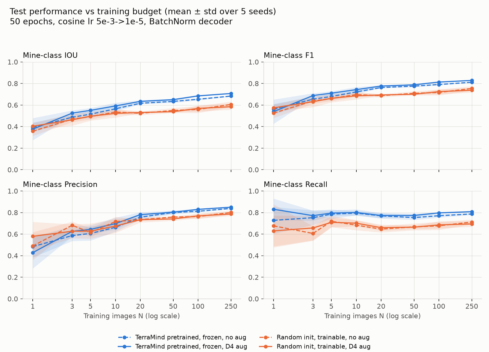
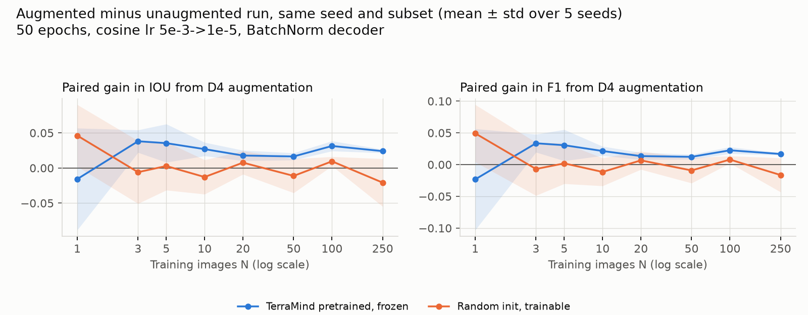

# TerraMind v1 Tiny on SmallMinesDS

Training-data efficiency and geometric augmentation for binary mine segmentation: a frozen,
pretrained [TerraMind v1 tiny](https://huggingface.co/ibm-esa-geospatial/TerraMind-1.0-tiny)
encoder versus the same encoder architecture trained from scratch, on
[SmallMinesDS](https://huggingface.co/datasets/ellaampy/SmallMinesDS) (2022, Sentinel-1 + Sentinel-2).

Everything needed to reproduce the 160 runs is in this repository: pinned dependencies, a pinned
dataset revision, deterministic training, and the analysis scripts.

## Requirements

- Windows/Linux with an NVIDIA GPU (tested: RTX 3080 Laptop 8 GB) and a driver that supports CUDA 12.8
- Python 3.12
- ~6 GB disk: 1.6 GB dataset zip, 1.8 GB extracted, 1.7 GB cache

## Setup

```powershell
python -m venv .venv
.\.venv\Scripts\Activate.ps1
pip install -r requirements.txt
python scripts\check_gpu.py        # must print "OK: GPU works with PyTorch."
python scripts\download_data.py    # SmallMinesDS from Hugging Face, pinned revision, checksum verified
python scripts\build_cache.py      # normalised per-split arrays in data/cache/
```

## Run

```powershell
python scripts\run_experiments.py  # main experiment: 160 runs, ~70 min on an RTX 3080 Laptop; resumable
python scripts\analyze.py          # tables + figures in results/main/

# optional variants (see "Protocol v1" below for how they were used)
python scripts\run_experiments.py --norm groupnorm --out results/groupnorm/runs.csv   # GroupNorm decoder
python scripts\run_experiments.py --steps 1600 --out results/steps1600/runs.csv       # fixed step budget
python scripts\analyze.py --runs results/<variant>/runs.csv
python scripts\compare_variants.py [--root results/v1_10ep]                           # side-by-side IoU curves
```

`run_experiments.py` appends one row per run to the runs file and skips runs already present,
so it can be interrupted and restarted. `--seeds` and `--budgets` restrict the grid.
TerraMind weights are downloaded from Hugging Face on first use.

## Experiment

Research question: how do training-set size and geometric augmentation affect mine
segmentation for a frozen pretrained TerraMind v1 tiny encoder versus the same architecture
trained from scratch?

| | Encoder init | Encoder training | Augmentation |
|---|---|---|---|
| A | TerraMind v1 tiny, pretrained | frozen | none |
| B | TerraMind v1 tiny, pretrained | frozen | random D4 symmetry |
| C | random | trainable | none |
| D | random | trainable | random D4 symmetry |

- Budgets N ∈ {1, 3, 5, 10, 20, 50, 100, 250} training images, 5 seeds, 4 conditions → 160 runs.
- Subsets are nested within a seed and identical across the four conditions.
- **Protocol v2 (current):** 50 epochs, evaluate the final weights. AdamW with a per-step cosine
  learning-rate schedule from 5e-3 (first update) to 1e-5 (last update), weight decay 0.01,
  batch size min(8, N), unweighted 2-class pixel cross-entropy, reshuffle every epoch, final
  partial batch kept, no early stopping / validation / checkpoint selection. Because the epoch
  count is fixed, the number of optimiser steps grows with N: 50 for N ≤ 5, 100 at N = 10, 150 at
  N = 20, 350 at N = 50, 650 at N = 100, 1600 at N = 250.
- The original plan specified 10 epochs at a constant lr of 1e-4 (protocol v1). Those results
  are kept under `results/v1_10ep/` and summarised at the end of this README.
- D4 augmentation: one of the 8 square symmetries (rotations by 0/90/180/270°, each with or
  without a horizontal flip), uniform, re-drawn per image presentation, applied identically to
  S1, S2 and the mask. Test images are never augmented.
- Metrics: mine-class IoU, F1, precision and recall from confusion counts pooled over the fixed
  644-image test set; zero-denominator metrics are reported as NA.

### Data

- SmallMinesDS 2022: 2135 patches of 128×128 px, train 1491 / test 644 (the dataset's own split).
- Inputs: Sentinel-2 L2A bands B2, B3, B4, B5, B6, B7, B8, B8A, B11, B12 and Sentinel-1 RTC
  VV, VH. The DEM band is not used.
- S1 is stored linear in the GeoTIFFs and converted to dB (10·log10) because TerraMind was
  pretrained on dB. Both modalities are standardised with TerraMind's pretraining mean/std
  (`data/cache/normalisation.json`), in every condition.
- Images are used at their native 128×128 (no resizing). TerraMind's fixed sin-cos positional
  table built for 128 px is exactly the top-left 8×8 crop of the 224 px table, so pretrained
  weights load unchanged.

### Model

Built with [TerraTorch](https://github.com/IBM/terratorch) 1.2.13, identical in every condition:

- Encoder `terramind_v1_tiny` (5.92 M params): S2L2A + S1RTC tokens are processed as one joint
  sequence; per-layer outputs of the two modalities are averaged (`merge_method="mean"`).
- Decoder side (0.97 M params, randomly initialised in every run): encoder layers 2/5/8/11 →
  8×8 maps → learned pyramid (32/16/8/4 px) → 4-block UNet decoder with 128/64/32/16 channels →
  1×1 conv to 2 classes → bilinear ×2 to 128×128. Normalisation layers are BatchNorm2d
  (`--norm groupnorm` swaps them for GroupNorm).

### Choices the plan left open

- **Low-N subsets.** 34 % of the training images contain no mine pixels. Per seed, the first 10
  images of the ordering are drawn at random from the 140 training images whose mine fraction
  lies in [0.25, 0.75]; the remaining images follow in random order. So N ≤ 10 budgets consist
  entirely of such images and larger budgets contain at least those 10. This departs from pure
  random sampling and makes the small-N training sets far more mine-heavy (25–75 %) than the
  test set (7.8 % mine pixels), which should be kept in mind when reading precision/recall at
  small N. `results/main/subsets.json` lists the patch ids of every (seed, N) subset.
- **Seed.** One seed fixes the subset, the decoder initialisation and the per-epoch batch
  order, so the four conditions of a seed are paired; augmentation draws come from a separate
  seeded stream, so enabling it does not change the batch order. The random-init encoder is
  also initialised from the seed.
- **Determinism.** cuDNN deterministic mode, `CUBLAS_WORKSPACE_CONFIG=:4096:8`,
  `torch.use_deterministic_algorithms(True)`, math attention kernel, and a cross-entropy
  written without the non-deterministic `nll_loss2d` kernel. Repeated runs are bit-identical
  on the same machine/software stack.

## Results (protocol v2: 50 epochs, cosine lr 5e-3 → 1e-5)

All 160 runs: `results/main/runs.csv` (one row per run, including confusion counts, learning
rates and the per-epoch training loss), `results/main/summary.md` (all four metrics),
`results/main/aug_gain.csv`, `results/main/environment.json` (software/hardware).
Total compute: 68 min on an RTX 3080 Laptop. No run diverged at lr 5e-3 and no metric is NA.



### Mine-class IoU on the test set (mean ± std over 5 seeds)

| N | steps | Pretrained frozen, no aug | Pretrained frozen, D4 aug | Random trainable, no aug | Random trainable, D4 aug |
|---|---|---|---|---|---|
| 1 | 50 | 0.392 ± 0.046 | 0.376 ± 0.103 | 0.357 ± 0.043 | **0.403 ± 0.030** |
| 3 | 50 | 0.487 ± 0.024 | **0.525 ± 0.025** | 0.469 ± 0.028 | 0.463 ± 0.054 |
| 5 | 50 | 0.515 ± 0.034 | **0.551 ± 0.022** | 0.493 ± 0.026 | 0.496 ± 0.040 |
| 10 | 100 | 0.565 ± 0.023 | **0.591 ± 0.029** | 0.535 ± 0.023 | 0.522 ± 0.039 |
| 20 | 150 | 0.616 ± 0.007 | **0.634 ± 0.012** | 0.523 ± 0.017 | 0.531 ± 0.007 |
| 50 | 350 | 0.633 ± 0.013 | **0.650 ± 0.008** | 0.550 ± 0.023 | 0.538 ± 0.005 |
| 100 | 650 | 0.653 ± 0.010 | **0.685 ± 0.007** | 0.559 ± 0.032 | 0.568 ± 0.028 |
| 250 | 1600 | 0.683 ± 0.004 | **0.707 ± 0.002** | 0.605 ± 0.027 | 0.584 ± 0.028 |

### Paired augmentation gain in IoU (aug − no aug, same seed and subset; seeds improved)



| N | Pretrained frozen | Random trainable |
|---|---|---|
| 1 | −0.016 ± 0.073 (3/5) | +0.046 ± 0.044 (4/5) |
| 3 | +0.038 ± 0.016 (5/5) | −0.006 ± 0.045 (2/5) |
| 5 | +0.035 ± 0.027 (5/5) | +0.003 ± 0.034 (3/5) |
| 10 | +0.027 ± 0.010 (5/5) | −0.013 ± 0.024 (2/5) |
| 20 | +0.018 ± 0.007 (5/5) | +0.008 ± 0.017 (3/5) |
| 50 | +0.016 ± 0.005 (5/5) | −0.011 ± 0.024 (2/5) |
| 100 | +0.031 ± 0.007 (5/5) | +0.010 ± 0.007 (5/5) |
| 250 | +0.024 ± 0.003 (5/5) | −0.021 ± 0.034 (2/5) |

### Findings

- **Every budget learns, including a single image** (IoU 0.36–0.40 at N = 1 in all conditions).
- **The frozen pretrained encoder wins at every N ≥ 10 in 5/5 seeds**, and the margin grows
  with N: +0.02–0.04 IoU at N ≤ 10, +0.08–0.12 from N = 20 on (0.683 vs 0.605 without
  augmentation at N = 250; 0.707 vs 0.584 with it). F1 at N = 250: 0.828 vs 0.737.
- **Data efficiency.** The frozen encoder with augmentation reaches with 10 images (IoU 0.591)
  what the trainable random encoder reaches with 250 (0.584–0.605), and with 20 images (0.634)
  it is beyond anything the random encoder achieves at any budget.
- **Augmentation helps the frozen encoder consistently**: +0.016 to +0.038 IoU, 5/5 seeds at
  every N ≥ 3 (at N = 1 the effect is −0.016 ± 0.073, 3/5 seeds). For the trainable random
  encoder it has no consistent effect (−0.021 to +0.046, 2–5 of 5 seeds, sign changes with N).
- **Seed variance** is small for the frozen encoder (std ≤ 0.013 at N ≥ 20, 0.002 at N = 250
  with augmentation) and 2–3× larger for the random encoder (up to 0.032).
- **Precision and recall.** The frozen encoder's advantage is mostly recall (0.77–0.81 vs
  0.65–0.71 at N ≥ 20); its precision is also higher from N = 20 (0.76–0.85 vs 0.73–0.80).
- Reading guide: all small-N training sets are mine-heavy by construction (see above), so
  precision and recall at N ≤ 10 reflect that composition; the test set has 7.8 % mine pixels.
  Standard deviations are over seeds (population std, n = 5).

## Protocol v1 (archived): 10 epochs, constant lr 1e-4

The plan's original protocol was run first; its results are kept under `results/v1_10ep/`
(`main/`, plus two supplementary grids and `variants.md` / `figures/variants.png` comparing
them). Mine-class IoU under v1 (mean ± std over 5 seeds):

| N | steps | Pretrained frozen, no aug | Pretrained frozen, D4 aug | Random trainable, no aug | Random trainable, D4 aug |
|---|---|---|---|---|---|
| 1–5 | 10 | 0.047 ± 0.038 | 0.047 ± 0.038 | 0.047 ± 0.038 | 0.047 ± 0.038 |
| 10 | 20 | 0.073 ± 0.063 | 0.102 ± 0.082 | 0.125 ± 0.091 | 0.153 ± 0.127 |
| 20 | 30 | 0.348 ± 0.117 | 0.411 ± 0.083 | 0.348 ± 0.109 | 0.381 ± 0.096 |
| 50 | 70 | 0.514 ± 0.034 | 0.519 ± 0.038 | 0.496 ± 0.028 | 0.433 ± 0.151 |
| 100 | 130 | 0.536 ± 0.020 | 0.545 ± 0.018 | 0.520 ± 0.030 | 0.509 ± 0.049 |
| 250 | 320 | 0.591 ± 0.018 | 0.594 ± 0.023 | 0.564 ± 0.024 | 0.563 ± 0.031 |

What v1 showed, and why the protocol was changed:

- With batch size N, 10 epochs are only 10 optimiser steps at lr 1e-4 for N ≤ 5. Every such run
  ended at a constant prediction (3 seeds all-mine, 2 seeds all-background) and the four
  conditions were identical; a GroupNorm variant (`results/v1_10ep/groupnorm/`) traced the
  constant outputs to BatchNorm's barely updated running statistics.
- The ordering of strategies was already the same as under v2: frozen pretrained ahead from
  N = 20 (+0.027 IoU at N = 250), augmentation helpful at N = 10–20.
- A variant with 320 steps for every N (`results/v1_10ep/steps320/`) showed that, given equal
  optimisation, every budget learns and augmentation adds +0.11 to +0.14 IoU at N = 3–10.
- Protocol v2 (50 epochs, cosine 5e-3 → 1e-5) gives every budget at least 50 steps and a
  decaying learning rate; under it the small-N collapse disappears and the gaps between
  conditions become consistent across seeds.

## Layout

```
smallmines/        data.py (loading, normalisation, subsets, D4), model.py, train.py, metrics.py
scripts/           check_gpu.py, download_data.py, build_cache.py, run_experiments.py,
                   analyze.py, compare_variants.py
results/main/      protocol v2: runs.csv, summary.csv, aug_gain.csv, summary.md,
                   subsets.json, environment.json, figures/
results/v1_10ep/   protocol v1: main/, groupnorm/, steps320/, variants.md, figures/variants.png
report/            experiment report (PDF)
data/              (git-ignored) dataset, split CSVs, cache
```
