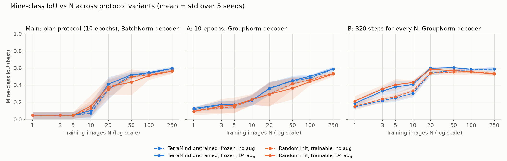

# TerraMind v1 Tiny on SmallMinesDS

Training-data efficiency and geometric augmentation for binary mine segmentation: a frozen,
pretrained [TerraMind v1 tiny](https://huggingface.co/ibm-esa-geospatial/TerraMind-1.0-tiny)
encoder versus the same encoder architecture trained from scratch, on
[SmallMinesDS](https://huggingface.co/datasets/ellaampy/SmallMinesDS) (2022, Sentinel-1 + Sentinel-2).

Everything needed to reproduce the 160 runs is in this repository: pinned dependencies, a pinned
dataset revision, deterministic training, and the analysis scripts.

## Requirements

- Windows/Linux with an NVIDIA GPU (tested: RTX 3080 Laptop 8 GB) and a driver that supports CUDA 12.8
- Python 3.12
- ~6 GB disk: 1.6 GB dataset zip, 1.8 GB extracted, 1.7 GB cache

## Setup

```powershell
python -m venv .venv
.\.venv\Scripts\Activate.ps1
pip install -r requirements.txt
python scripts\check_gpu.py        # must print "OK: GPU works with PyTorch."
python scripts\download_data.py    # SmallMinesDS from Hugging Face, pinned revision, checksum verified
python scripts\build_cache.py      # normalised per-split arrays in data/cache/
```

## Run

```powershell
python scripts\run_experiments.py  # main experiment: 160 runs, ~13 min on an RTX 3080 Laptop; resumable
python scripts\analyze.py          # tables + figures in results/main/

# supplementary variants (see below), ~14 min and ~62 min
python scripts\run_experiments.py --norm groupnorm --out results/groupnorm/runs.csv
python scripts\run_experiments.py --norm groupnorm --steps 320 --out results/steps320/runs.csv
python scripts\analyze.py --runs results/groupnorm/runs.csv
python scripts\analyze.py --runs results/steps320/runs.csv
python scripts\compare_variants.py # results/figures/variants.png + results/variants.md
```

`run_experiments.py` appends one row per run to the runs file and skips runs already present,
so it can be interrupted and restarted. `--seeds` and `--budgets` restrict the grid.
TerraMind weights are downloaded from Hugging Face on first use.

## Experiment

Research question: how do training-set size and geometric augmentation affect mine
segmentation for a frozen pretrained TerraMind v1 tiny encoder versus the same architecture
trained from scratch?

| | Encoder init | Encoder training | Augmentation |
|---|---|---|---|
| A | TerraMind v1 tiny, pretrained | frozen | none |
| B | TerraMind v1 tiny, pretrained | frozen | random D4 symmetry |
| C | random | trainable | none |
| D | random | trainable | random D4 symmetry |

- Budgets N ∈ {1, 3, 5, 10, 20, 50, 100, 250} training images, 5 seeds, 4 conditions → 160 runs.
- Subsets are nested within a seed and identical across the four conditions.
- 10 epochs, evaluate epoch 10. AdamW, lr 1e-4 constant, weight decay 0.01, batch size min(8, N),
  unweighted 2-class pixel cross-entropy, reshuffle every epoch, final partial batch kept,
  no early stopping / validation / checkpoint selection.
- D4 augmentation: one of the 8 square symmetries (rotations by 0/90/180/270°, each with or
  without a horizontal flip), uniform, re-drawn per image presentation, applied identically to
  S1, S2 and the mask. Test images are never augmented.
- Metrics: mine-class IoU, F1, precision and recall from confusion counts pooled over the fixed
  644-image test set; zero-denominator metrics are reported as NA.

### Data

- SmallMinesDS 2022: 2135 patches of 128×128 px, train 1491 / test 644 (the dataset's own split).
- Inputs: Sentinel-2 L2A bands B2, B3, B4, B5, B6, B7, B8, B8A, B11, B12 and Sentinel-1 RTC
  VV, VH. The DEM band is not used.
- S1 is stored linear in the GeoTIFFs and converted to dB (10·log10) because TerraMind was
  pretrained on dB. Both modalities are standardised with TerraMind's pretraining mean/std
  (`data/cache/normalisation.json`), in every condition.
- Images are used at their native 128×128 (no resizing). TerraMind's fixed sin-cos positional
  table built for 128 px is exactly the top-left 8×8 crop of the 224 px table, so pretrained
  weights load unchanged.

### Model

Built with [TerraTorch](https://github.com/IBM/terratorch) 1.2.13, identical in every condition:

- Encoder `terramind_v1_tiny` (5.92 M params): S2L2A + S1RTC tokens are processed as one joint
  sequence; per-layer outputs of the two modalities are averaged (`merge_method="mean"`).
- Decoder side (0.97 M params, randomly initialised in every run): encoder layers 2/5/8/11 →
  8×8 maps → learned pyramid (32/16/8/4 px) → 4-block UNet decoder with 128/64/32/16 channels →
  1×1 conv to 2 classes → bilinear ×2 to 128×128.

### Choices the plan left open

- **Low-N subsets.** 34 % of the training images contain no mine pixels. Per seed, the first 10
  images of the ordering are drawn at random from the 140 training images whose mine fraction
  lies in [0.25, 0.75]; the remaining images follow in random order. So N ≤ 10 budgets consist
  entirely of such images and larger budgets contain at least those 10. This departs from pure
  random sampling and makes the small-N training sets far more mine-heavy (25–75 %) than the
  test set (7.8 % mine pixels), which should be kept in mind when reading precision/recall at
  small N. `results/subsets.json` lists the patch ids of every (seed, N) subset.
- **Seed.** One seed fixes the subset, the decoder initialisation and the per-epoch batch
  order, so the four conditions of a seed are paired; augmentation draws come from a separate
  seeded stream, so enabling it does not change the batch order. The random-init encoder is
  also initialised from the seed.
- **Determinism.** cuDNN deterministic mode, `CUBLAS_WORKSPACE_CONFIG=:4096:8`,
  `torch.use_deterministic_algorithms(True)`, math attention kernel, and a cross-entropy
  written without the non-deterministic `nll_loss2d` kernel. Repeated runs are bit-identical
  on the same machine/software stack.

## Results

All 160 runs: `results/main/runs.csv` (one row per run, including confusion counts and the
per-epoch training loss), `results/main/summary.md` (all four metrics), `results/main/aug_gain.csv`,
`results/main/environment.json` (software/hardware). Total compute: 13 min on an RTX 3080 Laptop.


### Mine-class IoU on the test set (mean ± std over 5 seeds)

| N | steps | Pretrained frozen, no aug | Pretrained frozen, D4 aug | Random trainable, no aug | Random trainable, D4 aug |
|---|---|---|---|---|---|
| 1 | 10 | 0.047 ± 0.038 | 0.047 ± 0.038 | 0.047 ± 0.038 | 0.047 ± 0.038 |
| 3 | 10 | 0.047 ± 0.038 | 0.047 ± 0.038 | 0.047 ± 0.038 | 0.047 ± 0.038 |
| 5 | 10 | 0.047 ± 0.038 | 0.047 ± 0.038 | 0.047 ± 0.038 | 0.047 ± 0.038 |
| 10 | 20 | 0.073 ± 0.063 | 0.102 ± 0.082 | 0.125 ± 0.091 | 0.153 ± 0.127 |
| 20 | 30 | 0.348 ± 0.117 | **0.411 ± 0.083** | 0.348 ± 0.109 | 0.381 ± 0.096 |
| 50 | 70 | 0.514 ± 0.034 | **0.519 ± 0.038** | 0.496 ± 0.028 | 0.433 ± 0.151 |
| 100 | 130 | 0.536 ± 0.020 | **0.545 ± 0.018** | 0.520 ± 0.030 | 0.509 ± 0.049 |
| 250 | 320 | 0.591 ± 0.018 | **0.594 ± 0.023** | 0.564 ± 0.024 | 0.563 ± 0.031 |

### Paired augmentation gain in IoU (aug − no aug, same seed and subset; seeds improved)


| N | Pretrained frozen | Random trainable |
|---|---|---|
| 10 | +0.029 ± 0.028 (4/5) | +0.028 ± 0.055 (3/5) |
| 20 | +0.063 ± 0.050 (5/5) | +0.033 ± 0.029 (5/5) |
| 50 | +0.005 ± 0.006 (4/5) | −0.063 ± 0.127 (3/5) |
| 100 | +0.009 ± 0.012 (3/5) | −0.011 ± 0.021 (2/5) |
| 250 | +0.004 ± 0.006 (3/5) | −0.001 ± 0.014 (3/5) |

### Findings

- **N ≤ 5 is below the floor of this protocol.** With batch size N, 10 epochs are only 10
  optimiser steps at lr 1e-4, and every run ends at a constant prediction: 3 seeds predict
  "mine" everywhere (precision = test base rate 0.078), 2 seeds predict "background"
  everywhere (IoU 0, precision NA). Which of the two happens is set by the shared decoder
  initialisation, so all four conditions are identical to 3 decimals here. These budgets say
  nothing about the encoders. (Supplementary experiment A below traces the constant output to
  the decoder's BatchNorm running statistics; B shows that with enough steps every N learns.)
- **The frozen pretrained encoder wins from N = 20 upward**, and the margin over the trainable
  random encoder grows with N: +0.018 IoU at N = 50, +0.016 at 100, +0.027 at 250 (no aug), with
  lower seed variance. The random encoder is trainable but, within this fixed budget, never
  closes the gap.
- **Geometric augmentation helps most where data is scarce.** For the frozen encoder the
  paired gain is +0.03 IoU at N = 10, +0.06 at N = 20 (5/5 seeds), and a small but mostly
  positive +0.004…+0.009 at N ≥ 50. For the random encoder it helps at N = 10–20 and is neutral
  or negative beyond that.
- **One outlier.** Random encoder, D4 aug, N = 50, seed 3 reaches IoU 0.13 while its unaugmented
  twin reaches 0.45 with an almost identical training-loss curve; the model predicts 55 % of
  test pixels as mine. The pattern persists with a GroupNorm decoder (A: 0.12 vs 0.28) and
  disappears with more steps (B: 0.53 vs 0.54), so it is a slowly converging seed caught at
  70 steps, not a normalisation artefact. It is kept as-is because the protocol has no
  checkpoint selection. Without it the random-encoder gain at N = 50 is +0.001 ± 0.007.
- Reading guide: all small-N training sets are mine-heavy by construction (see above), so
  precision is low and recall high at N ≤ 20 in every condition; the test set has 7.8 % mine
  pixels. Standard deviations are over seeds (population std, n = 5).

## Supplementary experiments (beyond the plan)

Two single-factor variants probe the two limitations the main results expose. Data, subsets,
seeds, model, optimiser and metrics are unchanged; each variant is a full 160-run grid.

- **A — GroupNorm decoder** (`results/groupnorm/`, 14 min): the decoder side's 9 BatchNorm2d
  layers are replaced by GroupNorm (8 groups); protocol unchanged (10 epochs). Isolates the
  normalisation layer. Parameter count is identical.
- **B — equal optimisation budget** (`results/steps320/`, 62 min): every N trains for exactly
  320 optimiser steps (what the plan gives N = 250), with the GroupNorm decoder. Isolates the
  step budget. At N = 250 it is the same protocol as A, and the two produce identical confusion
  counts (a determinism check).



All three IoU tables are in `results/variants.md`; the full per-variant analyses are in
`results/groupnorm/` and `results/steps320/`.

### B: mine-class IoU with 320 steps for every N (mean ± std over 5 seeds)

| N | Pretrained frozen, no aug | Pretrained frozen, D4 aug | Random trainable, no aug | Random trainable, D4 aug |
|---|---|---|---|---|
| 1 | 0.144 ± 0.016 | 0.185 ± 0.039 | 0.150 ± 0.041 | **0.213 ± 0.059** |
| 3 | 0.218 ± 0.028 | 0.329 ± 0.046 | 0.238 ± 0.038 | **0.355 ± 0.043** |
| 5 | 0.247 ± 0.039 | 0.376 ± 0.074 | 0.263 ± 0.044 | **0.404 ± 0.066** |
| 10 | 0.303 ± 0.045 | 0.408 ± 0.044 | 0.333 ± 0.058 | **0.430 ± 0.030** |
| 20 | 0.540 ± 0.031 | **0.597 ± 0.018** | 0.539 ± 0.022 | 0.584 ± 0.026 |
| 50 | 0.571 ± 0.014 | **0.604 ± 0.013** | 0.553 ± 0.034 | 0.567 ± 0.029 |
| 100 | 0.577 ± 0.015 | **0.586 ± 0.007** | 0.553 ± 0.026 | 0.556 ± 0.017 |
| 250 | 0.586 ± 0.028 | **0.587 ± 0.020** | 0.537 ± 0.024 | 0.528 ± 0.027 |

### B: paired augmentation gain in IoU (aug − no aug; seeds improved)

| N | Pretrained frozen | Random trainable |
|---|---|---|
| 1 | +0.041 ± 0.027 (4/5) | +0.062 ± 0.049 (5/5) |
| 3 | +0.111 ± 0.041 (5/5) | +0.117 ± 0.037 (5/5) |
| 5 | +0.129 ± 0.050 (5/5) | +0.141 ± 0.036 (5/5) |
| 10 | +0.105 ± 0.040 (5/5) | +0.097 ± 0.060 (5/5) |
| 20 | +0.058 ± 0.024 (5/5) | +0.045 ± 0.026 (5/5) |
| 50 | +0.033 ± 0.004 (5/5) | +0.015 ± 0.017 (4/5) |
| 100 | +0.009 ± 0.020 (4/5) | +0.004 ± 0.013 (2/5) |
| 250 | +0.001 ± 0.029 (1/5) | −0.009 ± 0.021 (2/5) |

### What the variants show

- **The constant outputs at N ≤ 5 come from BatchNorm.** With GroupNorm (A) no run is constant
  any more (IoU 0.09–0.17 at N ≤ 5, no NA metrics): after only 10 updates BatchNorm's running
  statistics are still near their initial values, so the network behaves differently in eval
  mode than in training. Under the 10-epoch budget, however, GroupNorm converges more slowly at
  N = 20–100 (e.g. 0.450 vs 0.514 at N = 50) and matches BatchNorm at N = 250.
- **Given an equal 320-step budget (B), every N learns**, and the curves become smooth:
  IoU 0.14–0.21 from a single image, 0.54–0.60 from 20 images.
- **Augmentation is a small-data tool.** In B the paired gain is +0.11…+0.14 IoU at N = 3–10
  (5/5 seeds for both encoders), +0.05 at N = 20, +0.03 for the frozen encoder at N = 50
  (5/5), and ≈ 0 from N = 100 on. In the main experiment the same gains were visible only at
  N = 10–20, because smaller budgets never reached the point where augmentation matters.
- **Encoders under equal steps.** From N = 20 the frozen pretrained encoder is ahead, and the
  margin grows with N (+0.00 at 20, +0.02 at 50, +0.02 at 100, +0.05 at 250, no aug). At N ≤ 10
  the trainable random encoder is slightly ahead (by 0.01–0.03, within one standard deviation).
  The frozen encoder saturates early: with augmentation, N = 20 (0.597) already matches
  N = 250 (0.587) under this budget.
- Augmentation never significantly hurts in B; the negative random-encoder gains in the main
  experiment and in A at N ≥ 50 are driven by single slowly converging seeds.

## Layout

```
smallmines/        data.py (loading, normalisation, subsets, D4), model.py, train.py, metrics.py
scripts/           check_gpu.py, download_data.py, build_cache.py, run_experiments.py,
                   analyze.py, compare_variants.py
results/main/      the plan's experiment: runs.csv, summary.csv, aug_gain.csv, summary.md,
                   subsets.json, environment.json, figures/
results/groupnorm/ supplementary A (same layout)
results/steps320/  supplementary B (same layout)
results/           variants.md, figures/variants.png
data/              (git-ignored) dataset, split CSVs, cache
```
